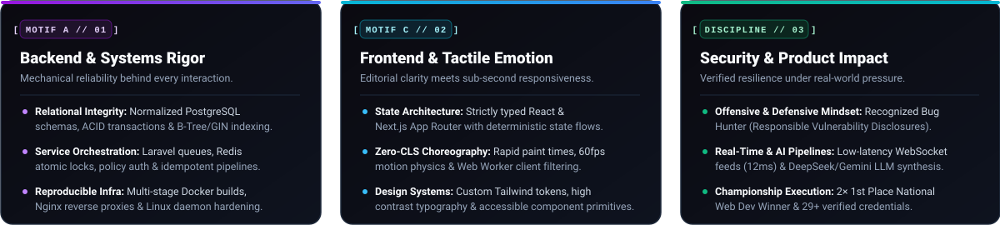
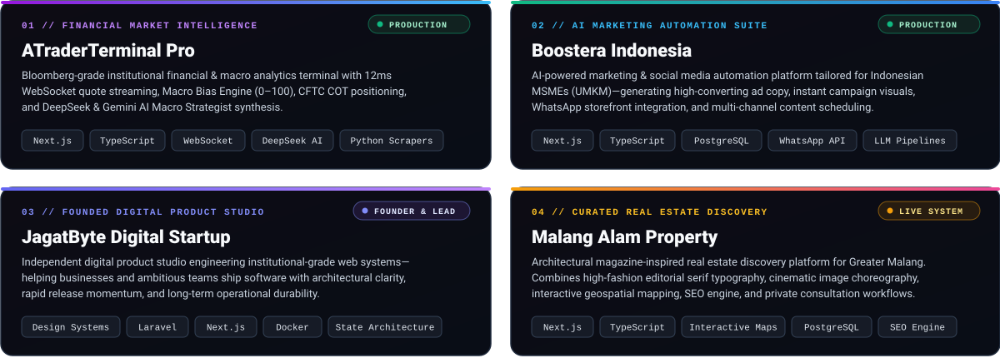
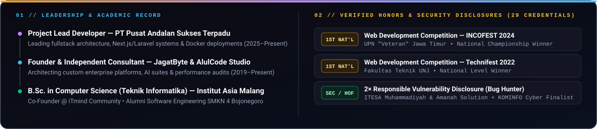

<!-- HERO BANNER -->

 

<!-- ANIMATED TYPING SUBTITLE -->

 

<!-- QUICK NAVIGATION & SOCIAL CHANNELS -->

  
  
  
  

  
  
  
  

---

### `01 // PERSPECTIVE & ENGINEERING THESIS`

> *"Many developers specialize either in how something looks or how it computes. I find the most interesting engineering happens right at their collision."*

I am **Muhammad Khoyron Ahlaqul Firdaus** (**AlulCode**), a **Fullstack Web Developer & System Architect** based in Malang, Indonesia. Currently serving as **Project Lead Developer** at **PT Pusat Andalan Sukses Terpadu** and Founder of **JagatByte Digital Product Studio**, I design and ship resilient, high-fidelity platforms—from real-time institutional financial terminals to AI automation suites for MSMEs.

  

---

### `02 // FLAGSHIP CASE STUDIES & PRODUCTION SYSTEMS`

Four flagship architectures engineered for real-world operations—combining low-latency data streaming, LLM intelligence synthesis, editorial UI choreography, and transactional durability.

  

<b>🔬 Explore Selected Open-Source Repositories & Lab Prototypes</b> <i>(Click to expand)</i>

 

| System / Repository | Domain & Architecture | Core Stack | Highlights |
| :--- | :--- | :--- | :--- |
| **[ATraderTerminal Pro](https://alulcode.vercel.app)** | Institutional Financial & Macro Terminal | `Next.js` `TypeScript` `WebSocket` `DeepSeek AI` | 12ms live quote stream, Macro Bias Engine (0–100), CFTC COT net positioning & AI Macro Strategist |
| **[Boostera Indonesia](https://alulcode.vercel.app)** | AI Marketing Suite for Indonesian MSMEs | `Next.js` `TypeScript` `PostgreSQL` `WhatsApp API` | Automated ad copywriting, campaign visual synthesis & multi-channel social scheduling |
| **[E-DaSi](https://github.com/AlulCode45/E-Dasi)** & **[REST-API](https://github.com/AlulCode45/REST-API-for-E-DaSi)** | Academic Student Data Platform | `TypeScript` `Express` `Prisma ORM` `JWT` | Decoupled fullstack architecture with strict role-based JWT authentication & relational schema |
| **[KarirConnect](https://github.com/AlulCode45/KarirConnect)** | Recruitment & Career Management CMS | `PHP 8+` `Laravel` `MySQL` `TailwindCSS` | End-to-end applicant tracking, employer portal, and vacancy orchestration workflow |
| **[TugasSiap](https://github.com/AlulCode45/TugasSiap)** | Collaborative Academic Task Manager | `PHP` `Laravel` `MySQL` `Bootstrap` | Deadline tracking, team collaboration workspaces, progress telemetry & task archiving |
| **[CatatanKecilku](https://github.com/AlulCode45/CatatanKecilku)** | Fast Client-Side Note Engine | `React` `Vite` `JavaScript` `CSS3` | Zero-latency state updates and clean responsive typography (★ 4 / ⑂ 3) |
| **[TradingView Indicator Strategy](https://github.com/AlulCode45/TradingView-Indicator-Strategy)** | Quantitative PineScript Collection | `PineScript` `Market Microstructure` | Custom algorithmic oscillators, smart-money overlays, and backtested trading strategies |
| **[BrainstormingAgent](https://github.com/AlulCode45/BrainstormingAgent)** | Autonomous AI Ideation Workflow | `Python` `LLM Orchestration` | Structured multi-step agent loop for technical brainstorming and architecture synthesis |

---

### `03 // PRODUCTION WORKBENCH & TECH ECOSYSTEM`

No arbitrary percentage bars or vanity meters—these are the production-tested languages, frameworks, data stores, and infrastructure tools I command daily to build reliable software.

| Layer | Technologies & Ecosystem | Core Engineering Focus |
| :--- | :--- | :--- |
| **Frontend & Client Runtime** |      | App Router, Server Components, zero-CLS layouts, Web Workers & design tokens |
| **Backend & Distributed APIs** |      | Idempotent queue workers, REST/WebSocket orchestration, policy auth & ERP modules |
| **Data, Storage & ORM** |      | Normalized schemas, ACID transactions, B-Tree/GIN JSONB indexing & atomic locks |
| **DevOps, Cloud & Tooling** |      | Multi-stage containers, reverse proxies, CI/CD pipelines & UI/UX system specs |

 

---

### `04 // LEADERSHIP RECORD & VERIFIED CREDENTIALS`

Backed by **29 verified industry credentials**, national software engineering championships, and official responsible vulnerability disclosure recognitions.

  

---

### `05 // GITHUB TELEMETRY & CONTRIBUTION MATRIX`

<!-- PRIMARY STATS & STREAK CARDS -->
<picture>
  
</picture>
<picture>
  
</picture>

 

<!-- COMMIT PROFILE DETAILS & TOP LANGUAGES -->
<picture>
  
</picture>
<picture>
  
</picture>

  

<!-- AUTOMATED PACMAN CONTRIBUTION GRAPH (UPDATED DAILY VIA GITHUB ACTIONS) -->
<picture>
  <source media="(prefers-color-scheme: dark)" srcset="https://raw.githubusercontent.com/AlulCode45/AlulCode45/output/pacman-contribution-graph-dark.svg" />
  <source media="(prefers-color-scheme: light)" srcset="https://raw.githubusercontent.com/AlulCode45/AlulCode45/output/pacman-contribution-graph.svg" />
  
</picture>

---

### `06 // INITIATE COLLABORATION`

Open for **fullstack architecture consulting**, **high-impact product engineering**, and **technical leadership collaborations**.

  <a href="https://alulcode.vercel.app"><b>🌐 Interactive Portfolio (alulcode.vercel.app)</b></a> •
  <a href="https://linkedin.com/in/alulcode"><b>💼 LinkedIn</b></a> •
  <a href="mailto:contact.alulcode@gmail.com"><b>✉️ contact.alulcode@gmail.com</b></a> •
  <a href="https://drive.google.com/drive/u/0/folders/1BBULOyTmHyKtjz1F1RZEV9GMIEd6jdVP"><b>📜 29 Official Certificates</b></a>

<b>AC MONOGRAM PHILOSOPHY</b> — <i>Design meets Engineering. Crafted with intention & mechanical rigor by Muhammad Khoyron Ahlaqul Firdaus.</i>

